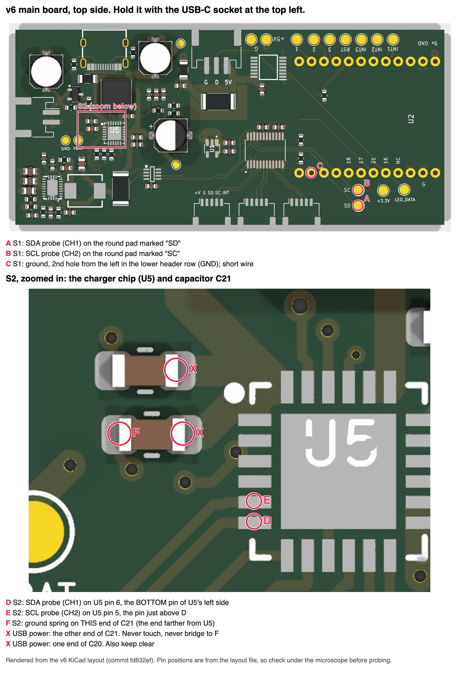
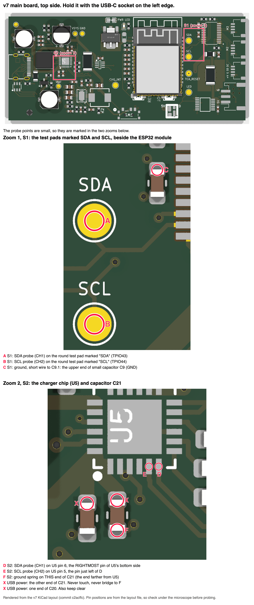

# Known-good reference (V9)

Purpose: prove that the probe, ground and scope chain reads a healthy I²C bus as healthy, using the **same** probes, ground method and settings planned for the board under test. This is `test-workflow-audit.md` §4.3, made concrete for our boards. It is step V9 of `dho804-setup-validation.md`.

**Outcome rule.** If the v6 reference fails these numbers with a validated setup, either the setup or the expectation is wrong. Resolve that before any v7 measurement is recorded. Never widen a pass limit to make the reference pass.

- Same conventions as `dho804-setup-validation.md`: steps are relayed as §4.8 blocks, commands run in Cursor's terminal at the repo root with the `q` helper (§0.3 there), every setting is set and read back, and every measured item goes on the Result panel while the scope is running (§0.4 there; the panel rule rests on an untested hypothesis).
- Scope facts are cited as *[facts: row]*, meaning `docs/initiatives/test-workflow-setup/PLAN.md` → "Verified instrument facts". **[own]** marks our own figures and heuristics.

## Words used here

- **I²C bus.** The two-wire bus the ESP32 uses to talk to the other chips. **SDA** is the data line, **SCL** the clock line. Both idle high (about 3.3 V), and a chip talks by pulling a line low.
- **Master end.** The end of the bus at the ESP32, which drives the clock and sends the address ("master-driven" bits are the ones the ESP32 pulls low). On v6 the ESP32 is on the T-Display board plugged into header U2; on v7 it is the ESP32-S3 module on the board. Probe points **A/B**, ground **C**.
- **BQ end.** The end of the bus at the battery-charger chip **U5** (a BQ24195). Probe points **D/E**, ground **F**.
- **Arm (S1, S2).** One measurement setup: where the two probes and the ground sit. **S1** = master end, **S2** = BQ end. It is also the `--arm` name in capture file names. It has nothing to do with the PCBite arms that hold the probes.
- **Pad and pin numbers.** `C21.1` and `C21.2` are the two ends (pads) of capacitor C21. `U5.6` is pin 6 of chip U5. You don't need to know which is which by eye: the pictures below mark every point with a letter.
- **V1–V9 vs v6/v7.** Capital V1–V9 are the steps of `dho804-setup-validation.md` (this procedure is V9). Lower-case v6 and v7 are the two main-board versions.
- **Ground spring.** The short spring that replaces the probe's ground lead. It touches a ground pad next to the probe tip.

## Pictures: where the probe points are

Every board point in this procedure has a letter on these pictures. **A/B/C** are the master end (S1); **D/E/F** are the BQ end (S2). The two **X** pads carry USB power: never touch them, and never let a spring or wire bridge them to F. Each picture is rendered from the board's KiCad layout, so check each point under the microscope before probing.

| Board | Picture |
|---|---|
| v6 (layout `fd632ef`) | [`img/v6-probe-points.png`](img/v6-probe-points.png) |
| v7 (layout `c2acffc`) | [`img/v7-probe-points.png`](img/v7-probe-points.png) |





On both boards D is U5 pin 6, E is U5 pin 5, F is the end of C21 farther from U5, and the X pads are the other end of C21 and one end of C20. U5 is turned 90° between the two layouts, so its pins point a different way in the two pictures; the pin numbers are the same. A and B are the round test pads TPIO43 and TPIO44 on both boards. C differs: on v6 it is a ground hole of header U2, on v7 one end of capacitor C9.

## Prerequisites

1. `dho804-setup-validation.md` V1–V8 passed **in this session**, with the probes, ground method and channel settings used below. Change any of them and V2–V8 have to be redone.
2. **Reference DUT:** the surviving **v6** main board, flashed with the **`v6-ref`** tag (`4da1c67`, env `lilygo-t-display-s3`; its I²C init is in the tag message: `Wire.begin(43, 44)`, 400 kHz, default drive, no filters, default pulls). Flashing it is the card's step, not this procedure's.
3. The card names the arms, the probes and the channels. This procedure gives the points and the pass table.
4. **Probes stay off the board until a step puts them there.** V1–V4 use only the scope and its Cal output; V5 of the setup validation is the first step on the board, and step 1 below is where each arm's probes are placed. Every time probes or grounds go on or move, the board is unplugged first and checked under the microscope before it is powered on.

## Points (from the board files, not from memory)

Names come from the Phase 5 extraction of the KiCad PCB files, v6 `motion-play-main.kicad_pcb@fd632ef` and v7 `@c2acffc` *[facts: PCB probe points]*.

| Signal | Master end (v6 and v7) | BQ end, U5 (v6 and v7) |
|---|---|---|
| SDA | **A**: test pad **TPIO43** (`/I2C_SDA`) | **D**: **U5 pin 6** (`/I2C_SDA`) |
| SCL | **B**: test pad **TPIO44** (`/I2C_SCL`) | **E**: **U5 pin 5** (`/I2C_SCL`) |

- On v6 the master is U2 (the T-Display-S3 plugged into the board, pins 15/16). U5 is the BQ24195 on both boards. On v6 its package is rotated, but the pin numbers are the same.
- U5 is a 0.5 mm-pitch QFN (a tiny square chip with pins on all four sides). Its own GND pins (U5.2, U5.3) sit beside the signal pins and the exposed pad is under the package, so they are **not** ground points.
- Other v6 pads, for context (not marked in the pictures): TP4 (`PGND`), TP_GND1 (GND, about 36 mm from U5), TP_3V1 (+3.3 V), TP_5V1 (+5 V).

## Ground: the same-ground-length rule

Use the **same ground type and length on every board you compare**, not "whatever pad is closest". Otherwise the comparison is uneven.

| Probing at | Ground point | Ground on v6 | Ground on v7 | Use |
|---|---|---|---|---|
| D/E (U5 pins 6/5) | **F** (C21.2) | 2.64 mm | 2.64 mm | **Yes.** Identical on both boards, so a ground spring on pad F is the same ground on both |
| A/B (TPIO43/44) | **C**: v6 **U2.14** (header hole, through-hole); v7 **C9.1** (one end of the 100 nF capacitor C9) | 8.26 mm | 3.05 mm | The pads differ, so use the **same wire, ≤ 10 mm [own]**, on both boards and record its length |
| either | TP4 | 6.85 mm from U5 | 12.09 mm from U5 | **No.** "TP4 on both boards" is not the same ground length |

All distances are copper edge to copper edge, and run slightly low (roundrect corners ignored) *[facts: PCB probe points]*.

> **Bridging warning (C21).** Pad F (C21.2) is ground, but the other end of the same capacitor (C21.1, an **X** pad in the pictures) is **`Protected_VBUS`**, USB power. So is one end of C20 next to it (C20.1, the other **X** pad). A ground spring or wire that touches both ends of C21 shorts the charger input to ground. Land the ground on **pad F, on the side of the pad away from the X pad**, with the board **unplugged**, and look at it under the microscope before powering on.

Whether a spring stays put on pad F (C21.2, a small 0603-size pad) has not been tried. If it won't, use a ≤ 10 mm wire to pad F and record the length. Ground springs fit both the Rigol stock probe and the SQ500 *[facts: Ground springs]*.

## Arms

| Arm | CH1 (SDA) | CH2 (SCL) | Ground |
|---|---|---|---|
| **S1**, master end | pad **A** (TPIO43) | pad **B** (TPIO44) | wire to pad **C** (v6 U2.14, v7 C9.1; table above) |
| **S2**, BQ end | pad **D** (U5 pin 6) | pad **E** (U5 pin 5) | spring (or wire) on pad **F** (C21.2, the end of C21 farther from U5) |

Either probe type works on either channel: the SQ500 (fixed 10:1, the usual bench setup is two SQ500s in PCBite arms) or the Rigol stock probe at 10×. Either way, set the channel ratio to 10 and read it back (V2). Not the SQ10 (1:1) *[facts: SQ10 attenuation]*.

## Which transaction to capture

On `v6-ref` the BQ24195 is addressed **only at boot**. `configureBQ24195()` in `firmware/src/main.cpp` @ `4da1c67` first sends an address-only probe to 0x6B, then writes REG00 and REG05. After that, bus traffic is to the TCA9548A (0x70) and the VCNL4040s (0x60). So the reference frame is caught by setting the scope to trigger once (single sweep) and then restarting the board. The firmware restarts when the board's **RIGHT button (GPIO 14)** is pressed (boot banner in the same file), or power-cycle it.

The expected address byte on the wire is **`D6`** (0x6B, write), followed by ACK.

## Steps, per arm

1. **Probes on.** If V5–V8 left the probes on this arm's pads, check them under the microscope against the picture and go to 1.5. Otherwise:
   1. **Unplug the board**: USB cable out, and no battery connected. It stays unplugged until step 1.4.
   2. Land the ground first, per the arm table: for S1 the wire to pad **C**; for S2 the spring on pad **F** (C21.2, the end of C21 farther from U5), away from the X pad (bridging warning above).
   3. Then the tips: CH1 (SDA) on pad **A** or **D**, CH2 (SCL) on pad **B** or **E**.
   4. **Look before powering on.** Under the microscope, check that each tip sits on its lettered pad and nothing touches an X pad. Only then plug the board in.
   5. Confirm the ground method matches what you recorded at step V6 of the setup validation for this arm.
2. **Channels and timebase:**
   ```
   q ':CHANnel1:DISPlay ON'; q ':CHANnel2:DISPlay ON'
   q ':CHANnel1:PROBe 10'; q ':CHANnel2:PROBe 10'
   q ':CHANnel1:SCALe 0.5'; q ':CHANnel2:SCALe 0.5'; q ':CHANnel1:OFFSet -1.65'; q ':CHANnel2:OFFSet -1.65'
   q ':CHANnel1:BWLimit OFF'; q ':CHANnel2:BWLimit OFF'
   q ':TIMebase:MAIN:SCALe 1e-5'
   q ':CHANnel1:PROBe?'; q ':CHANnel2:PROBe?'; q ':CHANnel1:SCALe?'; q ':CHANnel1:OFFSet?'; q ':TIMebase:MAIN:SCALe?'; q ':ACQuire:MDEPth?'; q ':SYSTem:ERRor?'
   ```
   **CHECK:** `10`, `10`, `5.000000E-01`, about `-1.65`, `1.000000E-5`, `1.0000E+04`, `0,"No error"`.
   - These are the reference's settings. Whatever they are, they must be the same as the settings planned for the board under test (the card states them), and V5 must have been run at them.
   - Memory depth must read **10 kpts**: `capture.py` refuses deeper memory, because a single read is verified only at 10 kpts *[facts: Waveform range]*. If it reads more, set the memory depth to 10k in the scope's acquire menu and write the button path in REPORT.
   - At 10 µs/div the 10 kpt record covers 100 µs at 10 ns per sample. That holds the whole address frame (about 25 µs at 400 kHz) with room to resolve a 300 ns edge.
3. **Decode and trigger** (as in V8), then thresholds for the rise time:
   ```
   q ':BUS1:MODE IIC'; q ':BUS1:IIC:SCLK:SOURce CHANnel2'; q ':BUS1:IIC:SDA:SOURce CHANnel1'
   q ':TRIGger:MODE IIC'; q ':TRIGger:IIC:SCL CHANnel2'; q ':TRIGger:IIC:SDA CHANnel1'; q ':TRIGger:IIC:WHEN STAR'
   q ':MEASure:SETup:MAX 70'; q ':MEASure:SETup:MIN 30'
   q ':BUS1:MODE?'; q ':TRIGger:MODE?'; q ':TRIGger:IIC:WHEN?'; q ':MEASure:SETup:MAX?'; q ':MEASure:SETup:MIN?'; q ':SYSTem:ERRor?'
   ```
   **CHECK:** `IIC`, `IIC`, `STAR`, `7.000000E+01`, `3.000000E+01`, `0,"No error"`. The thresholds default to 90/50/10 %, so the 30 → 70 % rise time is wrong unless they read back 70 and 30 *[facts: Measurement thresholds]*. Setting them has not been tried yet. If the read-back is wrong, set them in the measure menu and write the button path in REPORT.
4. **Result panel, scope running.** Put **Vtop, Vbase and Rise time** for CH1 and CH2 on the panel:
   ```
   for c in 1 2; do for i in VTOP VBASe RTIMe; do q ":MEASure:ITEM $i,CHANnel$c"; done; done
   ```
   **CHECK:** the Result panel shows the six items, each with a number. If one is missing, add it by hand and note the path. (`RTIMe` has not been queried on this scope yet. If it reads `9.9E37`, the CSV check in step 7 still gives the rise time.)
5. **Catch one frame (single trigger):** `q ':TRIGger:SWEep SING'`, then `q ':TRIGger:SWEep?'`. **CHECK:** `SING`, and the screen waits for a trigger. Press the board's **RIGHT button** (or power-cycle it). **CHECK:** the scope triggers once and stops, and the decode row reads **`D6`** then ACK. If it shows another address, set SINGLE again and restart again.
6. **Capture:**
   ```
   python3 tools/lab/capture.py --test <V7R-NNN> --arm <S1|S2> --items VTOP,VBASe,RTIMe --session lab/log/<YYYY-MM-DD_sNN>.yaml
   ```
   **CHECK:** the output ends `The scope is left STOPPED.` and lists the `.png`, `.csv` and `.setup.bin`. Note any `NOTE: … invalid` line in REPORT.
7. **Session work (no operator action):** open the PNG and write the `ai_read` entry. Then, from the CSV:
   - **V_OL:** the mean of SDA over the flat middle of a **master-driven 0-bit**. In `D6` = `1101 0110`, those are address bits 5 and 3 and the R/W bit (bit 0). The 9th-clock **ACK low is driven by the BQ24195, so exclude it**. Record the bit and the sample range as the value's `gate`. Vbase alone is only a cross-check, because it also includes the ACK low.
   - **Rise time:** 30 → 70 % on each SDA and SCL rising edge in the frame, from the samples. Record the RTIMe panel value next to it. The scope's percentages are of its own Vbase–Vtop span, while UM10204 uses 0.3–0.7 V_DD. With Vbase near 0 V and Vtop near 3.3 V the two agree within a few per cent **[own]**.
   - **Idle high:** Vtop, or the mean of the samples before the START.
   - **Decode:** the address byte and ACK, as read from the PNG.
   This CSV reading stands in for the audit's cursor confirmation; the cursor menus have not been recorded.
8. Press **RUN/STOP** once, set the sweep back with `q ':TRIGger:SWEep AUTO'`, and move to the next arm. To move the probes: **unplug the board first**, then lift the tips and the ground, then go back to step 1.

## Pass table (UM10204, V_DD = 3.3 V)

| Quantity | Pass | Note |
|---|---|---|
| V_OL, master-driven 0-bit | **≤ 0.4 V** (UM10204, at 3 mA sink) | **Estimate [own], not a pass band:** tens of mV, ≈ 35 mV at drive CAP_3, from the ESP32-S3 datasheet's typical I_OL (28 mA at 0.495 V). `v6-ref` runs the default drive, for which the datasheet gives no figure. **> 0.2 V on a working bus = investigate the setup [own heuristic].** |
| V_IL threshold | 0.3 V_DD = 0.99 V | reference only, not measured |
| V_IH threshold | 0.7 V_DD = 2.31 V | reference only, not measured |
| Idle high | **3.135 V to 3.465 V** (3.3 V ± 5 %) | same limit as step V7 |
| Rise time, 30 → 70 % | **≤ 300 ns** at 400 kHz (`v6-ref` runs 400 kHz); ≤ 1000 ns at 100 kHz | from the CSV; the RTIMe panel value is a cross-check |
| Decode | **`D6`** then ACK | the BQ24195 probe at boot |

The V_OL estimate and its limits are in *[facts: ESP32-S3 V_OL]*. The datasheet's V_OL max (0.33 V) is a no-load figure, so it is not a bound at our ≈ 2 mA. Don't quote 30–80 mV as an expectation; only the order of magnitude follows from the datasheet.

## Secondary reference (optional)

A bench I²C bus, such as the Arduino Nano 33 IoT with any breakout, at 100 kHz. Same probes, same ground method, same settings. The rise-time limit there is ≤ 1000 ns.

## Recording

- One log entry per arm, from `capture.py`. Fill `feature` (for example "SDA, master-driven 0-bit, address bit 3, flat region"), `raw_observation` (operator, verbatim), `channels.CH<n>.{probe, signal, point}` (for example `point: U5.6`), and the CSV-derived values with their `gate`.
- In the card: pass or fail per row of the pass table, citing the evidence files.
- Set `validation.notes` in the session log to "V9 <card ID> pass" or "fail".
